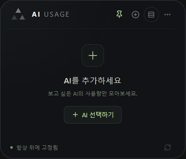
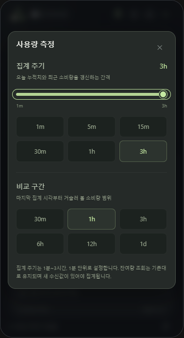
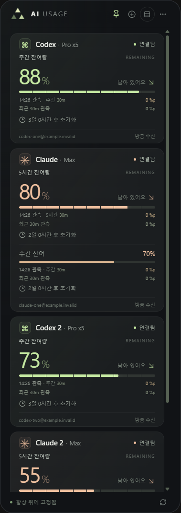
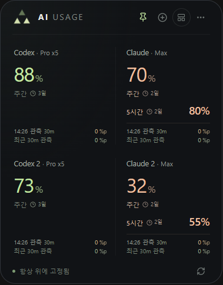
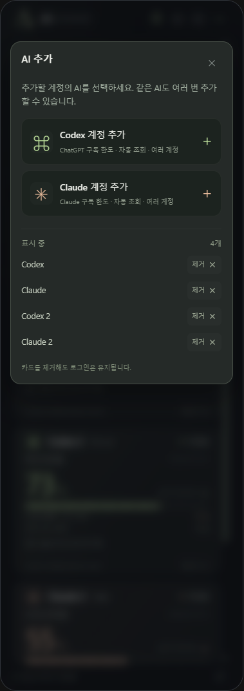
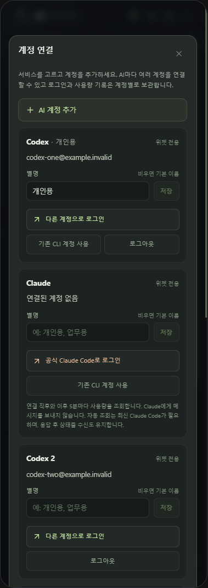
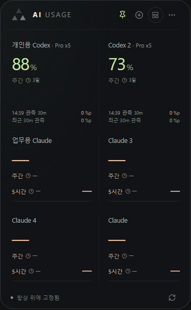

# AI Usage Widget

Codex와 Claude의 구독 잔여량을 확인하는 데스크톱 앱입니다. Windows에서는 WPF + React 위젯으로, macOS에서는 메뉴 막대의 삼각형 아이콘을 눌러 여는 카드로 사용합니다.

## macOS 메뉴 막대 앱

macOS 13 이상에서 사용할 수 있습니다. 이 저장소에서 한 번 빌드한 뒤 `run-macos.command`를 더블 클릭하거나, 생성된 `artifacts/macos/AI Usage.app`을 실행합니다.

```bash
./build-macos.sh
./run-macos.command
```

빌드에는 Xcode Command Line Tools(`xcode-select --install`), Node.js와 npm이 필요합니다. 실행 시에는 macOS 기본 AppKit·WebKit을 사용하므로 Node.js와 .NET 런타임이 필요하지 않습니다. 사용량을 확인할 서비스의 공식 Codex CLI 또는 Claude Code CLI는 별도로 설치해야 합니다.

- 메뉴 막대의 삼각형을 클릭하면 사용량 카드가 열립니다. 다른 곳을 클릭하거나 Escape·카드의 삼각형을 누르면 닫힙니다.
- 창을 닫아도 Codex는 60초, Claude는 5분 간격으로 사용량을 조회합니다. 카드 상단의 새로고침 버튼이나 `⌘R`·`F5`로 즉시 갱신할 수 있습니다.
- `+`에서 AI를 추가한 뒤 `설정 → 계정 관리`에서 로그인하거나 기존 CLI 계정을 연결합니다. 첫 실행에 기존 계정을 자동으로 연결하지 않습니다.
- 아이콘 우클릭 메뉴에서 카드 열기·새로고침·종료를 할 수 있습니다. Dock에는 별도 아이콘이 표시되지 않습니다.
- macOS 저장 위치는 `~/Library/Application Support/AIUsageWidget`입니다. Windows의 `%LOCALAPPDATA%\AIUsageWidget`은 유지됩니다.

현재 Mac의 CPU 아키텍처로 빌드합니다. 로컬 빌드용 임시 서명을 사용하며, 다른 사용자에게 배포할 Developer ID 서명·공증은 포함하지 않습니다. macOS 개발·검증과 CLI 경로 설정은 [macOS 개발 안내](MacUsageWidget/README.md)를 참고하세요.

## 구동 화면

실제 WPF + WebView2 앱에서 캡처한 화면입니다. 아래 사용량 수치는 검증용 예시 데이터이며, 개인 계정 정보는 포함하지 않았습니다.

<table>
  <tr>
    <th>자세히 보기</th>
    <th>간략히 보기 · 로고만 보기</th>
  </tr>
  <tr>
    <td valign="top"></td>
    <td valign="top">
      
      <p>삼각형을 누르면 로고만 남고, 다시 누르면 이전 화면으로 돌아옵니다.</p>
      
    </td>
  </tr>
</table>

<details>
<summary>처음 실행 · 사용량 측정 설정 화면</summary>

처음 실행할 때 원하는 AI를 추가합니다. 사용량 집계 주기는 1분~3시간, 비교 구간은 30분~1일 범위에서 선택할 수 있습니다.




</details>

<details>
<summary>여러 AI 계정 화면</summary>

Codex·Claude의 여러 계정을 각각 로그인해 한 대시보드에서 확인할 수 있습니다. 아래 이메일과 사용량은 모두 검증용 예시입니다.





</details>

<details>
<summary>계정 별명 설정</summary>

계정별로 개인용·업무용 등의 별명을 AI 이름 옆에 표시할 수 있습니다. 아래 계정과 수치는 검증용 예시입니다.




</details>

## Windows 빠른 시작

### 실행에 필요한 것

| 항목 | 준비 내용 |
|---|---|
| 운영체제 | Windows x64. 배포본은 Windows용 WPF 앱입니다. |
| 앱 파일 | `Release` 폴더 전체. EXE 외에 DLL, `Web`, `Bridge` 등의 파일도 필요합니다. |
| 화면 엔진 | [Microsoft Edge WebView2 Runtime](https://developer.microsoft.com/en-us/microsoft-edge/webview2/). 설치되어 있지 않으면 Evergreen Runtime을 설치합니다. |
| Codex 연결 | Windows에서 실행할 수 있는 공식 [Codex CLI](https://learn.chatgpt.com/docs/codex/cli)와 ChatGPT 계정 로그인이 필요합니다. |
| Claude 연결 | Windows용 공식 [Claude Code CLI](https://code.claude.com/docs/en/setup#install-on-native-windows)와 Claude 구독 계정 로그인이 필요합니다. 이 앱은 `claude.exe`를 찾습니다. |
| 네트워크 | 계정 로그인과 사용량 조회에 인터넷 연결이 필요합니다. |

**연결하려는 서비스의 CLI만 설치하면 됩니다.** 배포본에는 .NET 런타임이 포함되어 있으므로 앱 실행을 위해 .NET을 따로 설치할 필요는 없습니다. 소스 빌드에 필요한 SDK와 Node.js는 [개발 안내](UsageWidget/README.md)에서 확인할 수 있습니다.

### 첫 계정 연결

1. 루트의 `run-widget.cmd`를 더블 클릭하거나 `Release/AIUsageWidget.exe`를 실행합니다.
2. 처음 표시되는 **AI 선택하기** 또는 상단 **+**에서 Codex·Claude 중 원하는 AI를 추가합니다.
3. 추가한 계정의 로그인 항목이 자동으로 열립니다. 나중에는 `설정(톱니바퀴) → 계정 관리`에서 계정을 선택합니다.
4. 해당 카드의 **ChatGPT로 로그인** 또는 **공식 Claude Code로 로그인**을 누르고 공식 로그인 화면에서 직접 완료합니다. Claude는 열린 CLI 창에서 필요한 코드 입력도 완료합니다.
5. 연결 관리 화면을 닫고 잔여량과 리셋 시간을 확인합니다. 필요하면 새로고침 버튼 또는 앱에 포커스가 있는 상태에서 **F5**를 누릅니다.

같은 AI를 여러 번 추가해 서로 다른 계정을 연결할 수 있습니다. 선택 목록과 순서는 로그인 전에도 저장되며, 앱을 다시 실행해도 유지됩니다.

## 표시값 읽는 방법

**관측 사용량은 위젯이 오늘 수신한 값의 변화량입니다. 하루 전체 사용량이나 토큰 수가 아닙니다.** 5시간 한도와 주간 한도는 각각 따로 계산합니다.

| 표시 | 의미 |
|---|---|
| 잔여량 `77%` | 서비스가 제공한 해당 한도의 남은 비율입니다. API 비용이나 컨텍스트 사용률과는 별개입니다. |
| `09:30 관측 −3%p` | 오늘 관측한 소비량과 마지막 사용량 수신 시각입니다. 예를 들어 잔여량이 80%에서 77%로 줄면 3퍼센트포인트(`%p`)를 소비한 것으로 관측합니다. |
| `최근 30m 관측` | 마지막 집계 시각을 기준으로, 선택한 비교 구간에 수신된 소비량을 합산한 값입니다. |
| 리셋까지 남은 시간 | 해당 한도의 초기화 예정 시각까지 남은 시간입니다. 마우스를 올리면 PC 현지 시간대의 날짜·시각을 확인할 수 있습니다. |
| `—` | 해당 값이 없거나 리셋 후 새 수신값을 기다리는 상태입니다. 데이터가 없는 계정을 100%로 표시하지 않습니다. |
| `초기화됨` | 알려진 리셋 시각이 지났습니다. 다음 조회로 새로운 한도를 확인할 때까지 해당 잔여량을 숨깁니다. |
| `이전 수신값` | 마지막 수신 후 5분이 지난 값입니다. 현재 사용량과 차이가 있을 수 있습니다. |
| `집계 대기` | 날짜가 바뀌었지만 오늘의 첫 집계가 아직 완료되지 않았습니다. |
| 계정 플랜 | 연결 정보에 있는 플랜을 표시합니다. 정보가 없으면 생략하며, Claude의 배수 정보를 임의로 추가하지 않습니다. |

간략히 보기에서 **Claude는 주간 잔여량을 크게**, 5시간 잔여량을 보조 행으로 표시합니다. 관측 누적치와 최근 소비량도 주간 기준입니다. Codex는 5시간 한도가 있으면 이를 우선 표시합니다. 자세히 보기에서는 제공되는 각 한도를 따로 확인할 수 있습니다.

수신 시각은 PC 현지 시각의 24시간 `HH:mm` 형식이며 자정은 `00:00`입니다. 관측 표시에 마우스를 올리면 관측 시작 시각·누적치 집계 시각·집계에 반영된 수신 시각을 확인할 수 있습니다. 집계 주기를 기다리는 동안에도 새 사용량을 받으면 표시 시각은 갱신되며, 캐시를 다시 읽을 때는 원본 수신 시각을 유지합니다.

오늘 관측한 현재 한도의 소비 구간은 막대에 옅은 색으로 남습니다. 한도가 초기화되면 막대의 소비 구간은 비우고 오늘 누적치는 유지합니다. PC 현지 자정에는 새 기준을 잡고, 같은 날 다시 실행하면 저장된 기록을 복원합니다. **첫 관측 전이나 앱 종료·미수신 중의 소비와 초기화 사이의 사용은 복원할 수 없습니다.**

### 조회와 집계 설정

| 동작 | 주기·설정 |
|---|---|
| Codex 사용량 자동 조회 | 60초 간격 |
| Claude 사용량 자동 조회 | 연결 직후·앱 재실행 시, 이후 5분 간격 |
| 수동 새로고침 | 새로고침 버튼 또는 F5. 표시 중인 AI를 조회합니다. |
| 집계 주기 | 기본 30분. 1분~3시간 범위에서 1분 단위로 선택합니다. |
| 비교 구간 | 기본 30분. `30m · 1h · 3h · 6h · 12h · 1d` 중 선택합니다. |

관측 표시를 누르거나 `설정 → 사용량 측정`에서 집계 주기와 비교 구간을 변경합니다. 집계 주기는 슬라이더 또는 `1m · 5m · 15m · 30m · 1h · 3h` 빠른 선택 버튼으로 설정합니다. 슬라이더는 놓거나 키보드 조작을 마치면 저장됩니다. 이전 버전의 3시간보다 긴 집계 주기는 3시간으로 보정하며 비교 구간은 유지합니다.

집계는 이미 수신한 기록을 로컬에서 합산합니다. **집계 주기를 줄여도 서비스 조회가 더 자주 발생하지 않으며, AI 모델 요청을 추가하지 않습니다.** 새 수신값이 없으면 집계 시각을 갱신하지 않습니다. 자정을 지나도 집계 시간표를 유지하며, 비교 구간을 바꾸면 마지막 집계 시각을 기준으로 다시 계산합니다.

## 화면 조작

| 조작 | 동작 |
|---|---|
| 상단 AI USAGE 글자 영역 드래그 | 위젯을 이동합니다. 핀을 켜도 이동할 수 있습니다. |
| 핀 버튼 | 다른 창 위에 항상 표시합니다. |
| 보기 전환 버튼 | 자세히 보기 ↔ 간략히 보기를 전환합니다. |
| 삼각형 로고 클릭 / Escape | 로고만 보기로 접거나 숨기기 직전 카드 화면으로 돌아옵니다. |
| 로고만 보기에서 드래그 | 작은 로고 창을 이동합니다. 클릭 또는 Enter/Space로 이전 카드 화면을 복원합니다. |
| `설정 → 화면 설정 → 화면 모서리` | 현재 모니터의 네 모서리 중 원하는 곳에 배치합니다. |
| `설정 → 화면 설정 → 부드러운 화면 전환` | 창 크기 전환과 전환 중 로고 회전 효과를 켜거나 끕니다. |
| `설정 → AI Usage 종료` | 앱을 종료합니다. |

카드 폭은 304 DIP, 로고만 보기는 48×48 DIP이며 Windows 배율에 맞춰 표시합니다. 카드 수에 따라 높이가 바뀌고 화면보다 많아지면 카드 영역을 스크롤할 수 있습니다. 위치·핀·보기 모드·마지막 카드 모드·전환 효과 설정을 저장합니다.

드래그를 놓으면 현재 모니터에서 창 중심이 위치한 사분면에 따라 접기 기준 모서리가 바뀝니다. 펼치고 접을 때 그 모서리를 유지하고, 작업 표시줄을 피하며 모니터 작업 영역 안에서 펼칩니다.

삼각형 로고는 표시 중인 모든 AI가 연결되어 있고 조회 오류가 없으면 밝기가 물결처럼 움직입니다. 연결이 끊기거나 조회 오류가 있는 AI가 있으면 회색으로 바뀌며, 빈 대시보드도 회색입니다. 조회·로그인 중에는 로고가 회전합니다. 숫자·막대는 부드럽게 변하고 잔여량 감소에는 잔상 효과를 표시합니다.

**로고만 보기에서도 사용량 조회와 집계는 계속됩니다.** Windows의 동작 줄이기 설정은 로더·숫자·막대 효과에 적용하며, 펼치기·접기는 위젯의 별도 설정을 따릅니다. 애니메이션의 구현 상세는 [개발 안내](UsageWidget/README.md)에 정리했습니다.

## 계정 관리

상단 **+** 또는 `설정 → 계정 관리 → AI 계정 추가`에서 원하는 AI를 추가합니다. Codex와 Claude 모두 여러 계정을 지원하며, 계정마다 로그인·잔여량·리셋 시간·관측 기록을 독립적으로 관리합니다. 한 계정의 로그아웃이나 조회 오류는 다른 계정에 영향을 주지 않습니다.

| 동작 | 로그인·카드에 미치는 영향 |
|---|---|
| 계정 항목 삭제 | Windows·macOS 모두 카드와 저장된 계정 태그를 목록에서 제거합니다. 다시 실행해도 복원 목록에 남지 않습니다. CLI 로그인 파일과 로컬 기록은 보존합니다. |
| 위젯 전용 계정 로그아웃 | 해당 전용 계정을 로그아웃합니다. Claude 상태줄 연결도 복원합니다. |
| 기존 CLI 계정 연결 해제 | 위젯 연결을 끊습니다. 기존 CLI 자체는 로그아웃하지 않으며, Claude는 연결한 상태줄을 복원합니다. |
| 다른 계정으로 로그인 | 해당 카드의 전용 로그인 계정을 변경합니다. |

`설정 → 계정 관리`에서 계정을 펼치면 계정 이메일, 연결 방식, 로그인 취소와 계정 변경을 확인할 수 있습니다. **기존 CLI 계정 사용**은 각 AI의 첫 계정 카드에서만 선택할 수 있습니다. 선택하면 CLI의 계정 변경을 해당 카드도 따라가며, 추가 계정은 위젯 전용 로그인으로 연결합니다.

별명은 연결 관리 화면에서 입력하고 **저장**을 누릅니다. 최대 24자이며 `Codex · 개인용`, `Claude · 업무용`처럼 AI 이름 옆에 표시됩니다. 비우고 저장하면 기본 이름으로 돌아갑니다. 긴 별명은 줄여 표시하며 마우스를 올리면 전체 이름과 계정 이메일을 확인할 수 있습니다. 별명 변경은 로그인과 관측 기록에 영향을 주지 않습니다.

### Codex 연결

**ChatGPT로 로그인**을 누르면 공식 브라우저 OAuth 화면에서 계정을 선택합니다. 로그인 중에는 취소하거나 **브라우저 다시 열기**를 사용할 수 있습니다. 로그인과 사용량 조회는 공식 CLI의 `codex app-server`에 위임하며, 위젯은 모델 요청이나 대화를 생성하지 않습니다.

앱은 기본 npm 설치 경로의 Windows x64 실행 파일, PATH의 `codex.exe`, 기본 npm 설치의 JS 진입점을 찾습니다. npm으로 설치하려면 [공식 설치 안내](https://github.com/openai/codex#installing-and-running-codex-cli)의 `npm install -g @openai/codex`를 사용합니다. API 키 로그인과 잔여 비율을 제공하지 않는 계정은 제한 안내를 표시합니다. 인증과 사용량 조회의 세부 흐름은 [개발 안내](UsageWidget/README.md)에 있습니다.

### Claude 연결

**공식 Claude Code로 로그인**을 누르면 공식 CLI의 `claude auth login --claudeai`가 브라우저 OAuth를 진행합니다. 열린 CLI 창과 브라우저에서 사용자가 직접 완료하며, 위젯이 대신 승인하지 않습니다.

연결 후에는 공식 CLI의 실험적 사용량 조회 기능으로 구독 한도를 받습니다. Claude에게 메시지나 도구 요청을 보내지 않으며, CLI가 인증과 토큰 갱신을 처리합니다. CLI 버전에 따라 지원 여부가 달라질 수 있습니다. 자동 조회 실패 시 기존 상태줄 수신값을 유지하며, 값이 없으면 업데이트·로그인 안내를 표시합니다. [공식 SDK의 실험 기능 추가 기록](https://github.com/anthropics/claude-agent-sdk-typescript/releases/tag/v0.3.169)을 참고하세요.

**이 계정으로 Claude Code 열기**를 누르고 작업 폴더를 선택하면 같은 계정으로 Claude Code가 열립니다. 해당 세션의 공식 `statusLine` 데이터도 수신합니다. Claude Code 대화 창을 닫아도 자동 조회는 계속되며, 같은 계정의 앱·웹·다른 PC 사용도 다음 조회에 반영됩니다.

전용 계정은 전용 폴더의 `settings.json`을 사용합니다. **기존 CLI 계정 사용**을 직접 선택한 경우에는 기존 Claude 설정의 상태줄을 백업·연결합니다. 기존 상태줄 명령의 출력 보존에는 Git Bash가 필요합니다. 연결 해제 시 상태줄을 복원하고 이후 변경된 다른 설정은 유지합니다. 계정 전환 시에는 이전 사용량 캐시를 비웁니다.

관련 공식 문서: [Claude Code 설치](https://code.claude.com/docs/en/setup), [상태줄](https://code.claude.com/docs/en/statusline), [CLI 명령](https://code.claude.com/docs/en/cli-reference), [설정](https://code.claude.com/docs/en/settings).

## 문제 해결

| 증상 | 확인 순서 |
|---|---|
| EXE를 찾을 수 없거나 카드 화면을 불러오지 못함 | `Release` 폴더 전체가 있는지 확인합니다. EXE만 복사했다면 DLL·`Web`·`Bridge`를 포함한 배포본 전체를 다시 준비합니다. |
| WebView2 초기화 실패 | [WebView2 Runtime](https://developer.microsoft.com/en-us/microsoft-edge/webview2/) 설치 상태를 확인한 뒤 앱을 다시 실행합니다. |
| CLI 설치 안내가 계속 표시됨 | 새 PowerShell 창에서 `codex --version` 또는 `claude --version`을 확인합니다. 앱이 인식하는 Windows 실행 파일·설치 경로는 [개발 안내](UsageWidget/README.md)에 있습니다. PATH를 바꿨다면 앱도 다시 실행합니다. |
| 로그인 미완료·다른 계정이 연결됨 | 연결 관리에서 카드의 이메일과 연결 방식을 확인합니다. 취소 후 다시 로그인하고, 브라우저에서 원하는 계정을 선택합니다. 로그인은 5분 안에 완료해야 합니다. Claude는 공식 CLI 창의 입력 대기도 확인합니다. |
| 구독 한도 없음·잔여 비율 미제공 | Codex는 ChatGPT 계정, Claude는 Claude 구독 계정으로 로그인했는지 확인합니다. 서비스가 비율을 제공하지 않는 계정은 잔여량을 표시할 수 없습니다. |
| Claude 자동 조회 실패·수신 대기 | 공식 Claude Code를 업데이트하고 로그인 상태·네트워크를 확인한 뒤 새로고침합니다. 자동 조회가 지원되지 않으면 연결된 Claude Code 세션의 응답 후 상태줄 수신을 사용할 수 있습니다. |
| 이전 수신값·조회 실패·초기화됨 | 마지막 수신 시각과 연결 상태를 확인하고 새로고침합니다. 초기화 예정 시각이 지나면 새 데이터가 올 때까지 해당 값은 `—`입니다. |
| 잔여량은 바뀌는데 관측 누적치는 그대로 | 집계 주기가 아직 지나지 않았을 수 있습니다. 사용량 측정 설정을 확인합니다. 수신 시각과 누적치 집계 시각은 별도로 관리합니다. |
| 기존 Claude 상태줄 출력이 사라짐 | Git Bash 설치와 경로를 확인합니다. 위젯은 `CLAUDE_CODE_GIT_BASH_PATH` 또는 `C:\Program Files\Git\bin\bash.exe`를 사용합니다. 필요하면 연결 관리에서 연결을 해제해 상태줄을 복원합니다. |
| 이미 실행 중이라는 메시지 | 기존 위젯 창을 사용합니다. 재실행하려면 기존 앱의 `… → 위젯 종료`로 종료한 뒤 실행합니다. |
| 설정을 적용하지 못함 | 사용자 데이터 폴더의 쓰기 권한과 계정 연결을 확인합니다. |

기본 오류 로그는 `%LOCALAPPDATA%\AIUsageWidget\widget.log`입니다. 발생 시각·작업 이름·예외 종류만 기록하며, 상세 CLI 오류 출력이나 대화 내용을 기록하지 않습니다. 문제를 보고할 때는 앱에서 보인 메시지, 사용한 CLI 버전, 재현 순서를 함께 적어주세요.

## 저장 위치와 개인정보

기본 저장 위치는 **`%LOCALAPPDATA%\AIUsageWidget`**입니다. 실행 파일 옆에 저장하지 않으므로 같은 Windows 사용자라면 실행 폴더를 옮기거나 배포본을 교체해도 설정과 계정 연결을 유지합니다.

| 파일·폴더 | 보관하는 내용 |
|---|---|
| `window-state.json` | 창 위치·고정·보기 모드·접기 기준 모서리·전환 효과 설정 |
| `dashboard.json` | 표시할 계정 카드 ID와 순서. 빈 목록도 유지하며 삭제한 계정 ID는 제거합니다. |
| `account-profiles.json` | 카드 ID·서비스·기본 이름·별명·연결 사용 여부와 기존 CLI 사용 여부. 이메일·토큰은 넣지 않습니다. |
| `connections.json`, `codex-accounts.json` | 이전 버전 연결·계정 메타데이터와의 호환 정보 |
| `measurement.json` | 집계 주기와 비교 구간 |
| `daily-usage.json` | 현재 날짜, 계정·플랜의 해시, 한도별 관측 기준·누적 변화량·마지막 집계 상태와 최대 48시간의 관측 변화 기록. 이메일·토큰·대화 내용은 넣지 않습니다. |
| `Accounts/Codex`, `Accounts/CodexProfiles/<프로필 ID>` | 첫 Codex 계정과 추가 계정별 전용 CLI 홈. 공식 CLI가 인증 상태를 보관·갱신합니다. |
| `Accounts/Claude`, `Accounts/ClaudeProfiles/<프로필 ID>` | 첫 Claude 계정과 추가 계정별 전용 CLI 설정·인증 상태와 상태줄 연결 파일 |
| Claude 연결 폴더의 `claude-usage.json` | 두 한도의 사용률·리셋 시각, 수신 시각과 조회 출처. 대화 내용·세션 경로·인증 토큰은 넣지 않습니다. |
| Claude 연결 폴더의 `usage-account.json` | 캐시가 어느 계정의 값인지 구분하는 이메일 |
| Claude 연결 폴더의 `claude-bridge.json`, `claude-settings-backup-*.json` | 이전 상태줄과 전체 Claude 설정의 백업 |
| `WebView` | WebView2 화면 엔진의 사용자 프로필 |
| `widget.log`, `widget.log.old` | 제한된 오류 로그와 이전 로그 |

전용 Claude 연결 파일은 해당 계정의 `UsageBridge` 폴더에, 기존 CLI 연결 파일은 `SystemClaudeBridge` 폴더에 보관합니다. 이전 버전의 로그인 폴더와 관측 기록은 유지하면서 공통 계정 목록으로 이관합니다. 표시하지 않는 계정은 주기적으로 조회하지 않습니다.

위젯은 Claude OAuth 토큰을 직접 읽거나 비공개 HTTP API로 전송하지 않습니다. **공식 CLI가 관리하는 인증 상태는 전용 계정 폴더에 남으며, 전체 데이터 폴더에는 이메일과 사용자 설정 백업도 포함됩니다.** 따라서 배포·문제 보고에는 데이터 폴더 전체를 포함하지 마세요. 기존 CLI 계정을 사용하면 인증 상태는 해당 CLI의 기존 저장소에서 관리합니다.

## 업데이트와 제거

### 업데이트

1. `… → 위젯 종료`로 앱을 종료합니다.
2. 새 배포본의 **Release 폴더 전체**로 교체합니다. 소스로 업데이트하는 경우에는 루트에서 `build-widget.ps1`을 실행합니다.
3. `run-widget.cmd` 또는 `Release/AIUsageWidget.exe`를 실행합니다.

`%LOCALAPPDATA%\AIUsageWidget`을 유지하면 계정·별명·표시 목록·창 위치·집계 설정과 저장된 관측 기록을 이어서 사용합니다. 앱을 끈 동안의 미수신 사용량까지 복원하는 것은 아닙니다.

### 앱 제거

1. 연결 관리에서 위젯 전용 계정은 **로그아웃**, 기존 CLI 계정은 **연결 해제**합니다. 숨긴 카드의 계정도 연결 관리에서 확인할 수 있습니다. Claude 연결 해제는 상태줄을 복원하므로 앱 파일을 지우기 전에 진행합니다.
2. `… → 위젯 종료`로 종료한 뒤 앱 배포 폴더를 삭제합니다.
3. 설정·관측 기록·전용 CLI 인증 상태까지 지우려면 `%LOCALAPPDATA%\AIUsageWidget`도 삭제합니다. 유지하면 다음 설치에서 다시 사용할 수 있습니다.

기존 CLI 계정의 연결 해제는 CLI 자체를 로그아웃하지 않습니다. CLI 자체를 제거하려면 해당 서비스의 공식 제거 안내를 따릅니다.

이전 버전에서 데이터 폴더 루트에 설치한 전역 Claude 상태줄을 복원하는 호환 명령은 다음과 같습니다. 현재 계정별 연결은 연결 관리 화면에서 해제합니다.

```powershell
.\Release\AIUsageWidget.exe --disconnect-claude
```

## 소스 빌드와 개발 안내

빌드에는 Windows, .NET 8 SDK, npm과 Node.js가 필요합니다. 현재 잠금 파일의 Vite는 **20.19 이상인 Node.js 20.x 또는 Node.js 22.12 이상**을 요구합니다. 루트에서 실행합니다.

```powershell
.\build-widget.ps1 -RestoreUI
.\run-widget.cmd
```

`build-widget.ps1`은 React UI를 빌드한 뒤 .NET 런타임을 포함한 Windows x64 배포본을 `Release`에 생성합니다. 이후 의존성을 다시 설치할 필요가 없으면 `-RestoreUI`를 생략할 수 있습니다.

[개발 안내](UsageWidget/README.md)에는 소스 구조, UI 미리보기, 검증 명령, 계정 격리, 서비스 확장과 삼각형 아이콘·애니메이션 구현을 정리했습니다. 반복 갱신 최적화의 측정 조건과 CPU·메모리 결과는 [성능 비교 기록](docs/performance.md)에서 확인할 수 있습니다.
