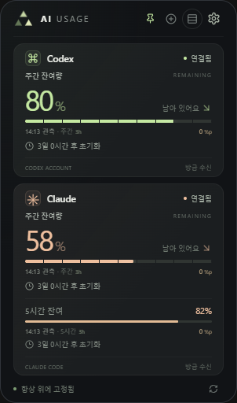
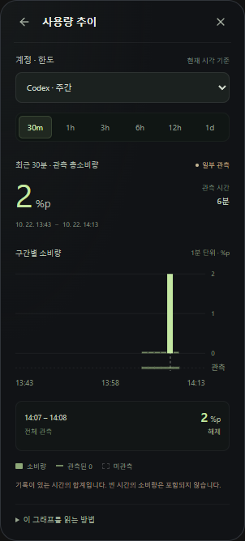

# AI Usage Viewer

Codex와 Claude의 **구독 잔여량·초기화 시간·관측 소비량**을 확인하는 Windows x64 데스크톱 위젯입니다. 여러 계정을 한곳에서 보고, 필요할 때 별도 사용량 추이 화면으로 최근 소비를 살펴볼 수 있습니다.

**[Windows 설치 파일 다운로드](https://github.com/Mellow1213/AI_Usage_Viewer/releases/latest/download/Mellow.AIUsageViewer-win-Setup.exe)** · [Portable ZIP](https://github.com/Mellow1213/AI_Usage_Viewer/releases/latest/download/Mellow.AIUsageViewer-win-Portable.zip) · [1.2.7 변경 사항](docs/releases/1.2.7.md) · [문제 보고](https://github.com/Mellow1213/AI_Usage_Viewer/issues)

> **지원 대상: Windows x64.** 1.2.7부터 Mac 빌드·CI·신규 배포를 중단했습니다. 과거 Mac 소스와 이미 공개된 릴리스는 보관합니다.

## 화면 예시

1.2.7의 Windows 앱에서 격리된 검증 프로필과 예시 데이터로 캡처했습니다. 실제 계정 정보가 아닙니다.

<p>
  
  
</p>

- [설치와 실행](#설치와-실행)
- [첫 계정 연결](#첫-계정-연결)
- [사용량 추이](#사용량-추이)
- [표시값과 사용 기록](#표시값과-사용-기록)
- [화면 조작과 설정](#화면-조작과-설정)
- [업데이트와 제거](#업데이트와-제거)
- [데이터와 개인정보](#데이터와-개인정보)
- [문제 해결](#문제-해결)
- [개발과 검증](#개발과-검증)
- [변경 이력과 문서](#변경-이력과-문서)
- [기여와 라이선스](#기여와-라이선스)

## 설치와 실행

### 요구 사항

| 항목 | 준비할 내용 |
|---|---|
| 운영체제·CPU | Windows x64. Mac·Linux용 신규 배포본은 제공하지 않습니다. |
| 화면 엔진 | [Microsoft Edge WebView2 Runtime](https://developer.microsoft.com/en-us/microsoft-edge/webview2/). 없다면 Evergreen Runtime을 설치합니다. |
| Codex | Windows용 공식 Codex CLI와 ChatGPT 구독 계정 |
| Claude | Windows용 공식 Claude Code CLI와 Claude 구독 계정. 앱은 `claude.exe`를 탐색합니다. |
| 네트워크 | 공식 CLI 로그인·한도 조회와 GitHub 업데이트 확인에 필요합니다. |

연결할 서비스의 CLI만 설치하면 됩니다. **앱 배포본에는 .NET 런타임이 포함됩니다.** 앱 실행에 .NET SDK나 UI 빌드용 Node.js는 필요하지 않습니다. CLI를 npm으로 설치했다면 해당 CLI의 Node.js 요구 사항은 별도입니다.

WSL에만 설치한 Linux CLI는 이 앱의 탐색 대상이 아닙니다. [지원하는 CLI 설치 경로](UsageWidget/README.md#계정-격리와-서비스-연동)를 참고하세요.

### 빠른 시작

1. 위의 **Windows 설치 파일**을 내려받아 설치합니다.
2. Windows 시작 메뉴에서 **AI Usage Viewer**를 실행합니다.
3. **AI 선택하기** 또는 상단 **+**에서 Codex·Claude를 추가합니다.
4. [계정을 연결](#첫-계정-연결)하고 사용량을 확인합니다.

| 다운로드 파일 | 용도 |
|---|---|
| `Mellow.AIUsageViewer-win-Setup.exe` | 일반 설치. 이후 앱 안에서 업데이트할 수 있습니다. |
| `Mellow.AIUsageViewer-win-Portable.zip` | 수동 실행용 전체 앱. EXE·DLL·`Web`·`Bridge`를 함께 유지합니다. |
| `*-full.nupkg`, `releases.win.json`, `RELEASES` | 설치된 앱이 사용하는 업데이트 패키지·피드입니다. 직접 실행할 파일이 아닙니다. |
| `SHA256SUMS`, `release-build.json` | 파일 무결성 확인과 빌드 출처 정보입니다. |

저장소의 `run-widget.cmd`는 설치본을 실행하는 진입점입니다. 설치본이 없으면 설치 안내를 표시하며 개발판으로 대신 실행하지 않습니다. 코드 서명 인증서는 현재 구성하지 않았습니다. SHA256은 파일 무결성 확인에 사용합니다.

## 첫 계정 연결

처음 실행할 때 기존 CLI 계정을 자동으로 추가하지 않습니다. 사용할 AI와 계정을 직접 선택합니다.

1. AI를 추가하면 **설정 → 계정 관리**에서 해당 계정이 열립니다.
2. **ChatGPT로 로그인** 또는 **공식 Claude Code로 로그인**을 선택하고 공식 브라우저·CLI 화면에서 완료합니다.
3. 이미 CLI에 로그인했다면 해당 AI의 첫 계정에서 **기존 CLI 계정 사용**을 선택할 수 있습니다.
4. 설정을 닫고 잔여량을 확인합니다. 추가 계정은 앱 전용 프로필로 연결해 서로 분리합니다.

재실행·업데이트 뒤 저장된 계정을 다시 연결하는 동안에는 연결 진행 상태를 표시합니다. 새 수신값이 도착하면 기존 잔여량을 갱신합니다.

계정별 별명은 펼친 계정의 입력란에서 **저장**합니다. 최대 24자이며 비우면 기본 이름으로 돌아갑니다. 별명 변경은 로그인·관측 기록에 영향을 주지 않습니다.

| 계정 관리 동작 | 결과 |
|---|---|
| 계정 항목 삭제 | 카드·계정 목록·별명을 제거하고 다음 실행에도 복원하지 않습니다. 해당 Claude 상태줄 연결도 해제합니다. |
| 앱 전용 계정 로그아웃 | 공식 CLI에서 해당 계정을 로그아웃합니다. 카드 항목은 유지합니다. |
| 기존 CLI 계정 연결 해제 | 앱 연결을 해제합니다. 기존 CLI 자체를 로그아웃하지 않습니다. |
| 다른 계정으로 로그인 | 해당 카드의 전용 로그인 계정을 변경합니다. |

계정 항목 삭제는 CLI 인증 파일과 로컬 관측 기록을 지우지 않습니다. 로그아웃까지 원하면 항목 삭제 전에 먼저 로그아웃하세요.

### Claude Code 연동

앱은 공식 CLI의 인증·사용량 조회 기능을 이용합니다. 자동 조회를 위해 Claude에 대화나 모델 요청을 만들지 않습니다. 사용량 조회는 실험적 `get_usage` 요청에 의존하므로 CLI 버전에 따라 동작이 달라질 수 있습니다. 실패하면 사용할 수 있는 마지막 상태줄 수신값을 유지합니다.

**이 계정으로 Claude Code 열기**에서 작업 폴더를 선택하면 같은 계정으로 CLI를 실행하고 공식 상태줄 데이터도 받습니다. CLI 창을 닫아도 앱의 자동 조회는 계속됩니다. 상태줄 설정은 연결 시 백업하고 해제 시 앱이 설치한 부분만 복원합니다. 이전 상태줄 명령의 출력을 보존하려면 Git Bash가 필요합니다.

## 사용량 추이

**설정 → 사용량 추이**에서 엽니다. 1.2.7에서는 총소비량과 그래프를 이 별도 화면에 모았습니다. 상세·간략 카드에서는 잔여량과 기존 관측 사용량을 확인합니다.

1. **계정 · 한도**를 선택합니다. 5시간과 주간 한도는 서로 다른 기준이므로 따로 봅니다.
2. **30m · 1h · 3h · 6h · 12h · 1d** 기간을 선택합니다.
3. **현재 시각에서 선택 기간만큼 거슬러 간 기록**을 즉시 합산합니다. 다음 서비스 조회나 일일 집계를 기다리지 않습니다.
4. 관측 총소비량, 실제 관측 시간과 시간대별 소비 그래프를 확인합니다.
5. 그래프에 마우스를 올려 상세를 보고, 클릭하면 선택을 고정합니다. ←·→, Home·End로 이동하고 `해제` 또는 Escape로 선택을 지웁니다.

기간이나 계정·한도를 바꾸면 구간 선택도 초기화됩니다. 화면을 열 때만 최근 시계열 데이터를 전달하며, 새 메시지가 없어도 시간이 지나 선택 범위를 벗어난 기록은 합계에서 제외합니다.

| 표시 | 의미 |
|---|---|
| 총소비량 `3%p` | 한도 사용률이 20%에서 23%로 증가했다면 3퍼센트포인트를 소비한 것으로 관측합니다. |
| 소비 막대 | 표시된 시간 단위로 묶은 관측 소비량입니다. 변화량은 수신 시각에 기록됩니다. |
| 기준선 `0` | 실제 관측한 시간에 소비 증가분이 없었습니다. |
| 빈 구간·`미관측` | 기록이 없어 소비량을 알 수 없습니다. 0으로 채우거나 추정하지 않습니다. |
| `일부 관측` | 기간 중 일부만 관측했습니다. 합계도 그 관측 부분만 포함하며 옅은 막대로 구분합니다. |
| 그래프 하단 `관측` 선 | 기록이 존재하는 시간을 표시합니다. |

토큰 수·API 요금·하루 전체 소비량을 보여주는 기능은 아닙니다. 앱 종료·잠자기·연결 오류·수신 공백 동안의 소비량은 소급 복원하지 않습니다. `이 그래프를 읽는 방법`을 펼치면 단위와 표시 기준을 확인할 수 있습니다.

## 표시값과 사용 기록

### 카드의 숫자

| 표시 | 의미 |
|---|---|
| 잔여량 `77%` | 서비스가 제공한 해당 구독 한도의 남은 비율입니다. API 비용·컨텍스트 사용률과는 다릅니다. |
| `09:30 관측`과 소비량 | 오늘 관측한 해당 한도의 소비량·마지막 수신 시각입니다. 수신 시각과 집계 시각은 별도입니다. |
| 초기화까지 남은 시간 | 해당 한도의 초기화 예정 시각입니다. 마우스를 올리면 현지 날짜·시간을 확인합니다. |
| `—`·`초기화됨` | 값이 없거나 초기화 후 새 수신값을 기다립니다. 자동으로 100%로 채우지 않습니다. |
| `이전 수신값` | 마지막 수신 후 5분이 지났습니다. |
| `집계 대기` | 현지 날짜가 바뀐 뒤 오늘의 첫 집계가 아직 끝나지 않았습니다. |

Claude는 주간 잔여량을 크게, 5시간 잔여량을 보조로 표시합니다. Codex는 5시간 한도가 있으면 우선 표시합니다. 각 한도의 %p는 합산하지 않습니다.

| 조회·집계 | 주기·설정 |
|---|---|
| Codex 자동 조회 | 앱 실행 중 60초 간격 |
| Claude 자동 조회 | 연결 직후·재실행 시, 이후 5분 간격 |
| 수동 새로고침 | 하단 버튼·F5로 표시 중인 계정 조회 |
| 오늘 관측 사용량 집계 | 기본 30분. 설정에서 1분~3시간, 1분 단위로 변경 |
| 사용량 추이 비교 구간 | 기본 30분. 최근 30분~24시간의 기록을 즉시 계산 |

**설정 → 사용량 측정**의 집계 주기는 서비스 조회 간격과 다릅니다. 주기를 줄여도 서비스 조회나 AI 요청이 추가되지 않습니다. 새 수신값이 없으면 집계 시각을 갱신하지 않습니다.

현재 한도가 초기화되면 해당 한도의 오늘 소비량은 새 기준에서 다시 쌓습니다. 추이·사용 기록의 과거 시계열은 보존하고 초기화 사이의 미관측 시간은 연결하지 않습니다. 현지 자정에는 오늘 관측치를 새로 집계합니다.

### 사용 기록

**설정 → 사용 기록**은 달력 기준의 장기 기록 화면입니다. 최근 7일의 일별 기록, 선택한 하루의 시간별 기록, 월요일 시작 8주의 주별 기록을 제공합니다. 화살표로 기간을 옮기고 막대를 선택해 소비량과 관측 시간을 확인합니다.

수신 기록은 기기 내 `usage-history.json`에 최대 90일 보관합니다. 기존 48시간 집계 파일을 전체 사용 기록으로 소급 변환하지 않습니다. 재실행·연결 오류·카드 제외·10분 초과 수신 공백·초기화 전후에는 관측 구간을 이어 붙이지 않습니다. 계정·플랜·한도 기준이 바뀌면 별도 기록으로 분리합니다. 주별 기록의 달력 주와 서비스의 주간 초기화 주기는 다를 수 있습니다.

## 화면 조작과 설정

| 조작·메뉴 | 동작 |
|---|---|
| 상단 `AI USAGE` 글자 영역 드래그 | 고정 상태에서도 위젯을 이동합니다. |
| 핀 | 다른 창 위에 표시하거나 고정을 해제합니다. |
| 보기 전환 | 자세히 ↔ 간략히 보기 |
| 삼각형 로고·Escape | 로고만 보기 ↔ 이전 카드 모드. 그래프 탐색 중 Escape는 선택 해제에 사용합니다. |
| 로고 드래그·클릭 | 로고 창을 이동하거나 이전 카드로 돌아갑니다. Enter·Space로도 복원합니다. |
| 로고 우클릭·Shift+F10·트레이 우클릭 | 로고 고정·전체 화면 숨김·5분간 숨기기·복원 |
| 설정 → 화면 설정 | 전환 효과, 화면 모서리, 로고 고정·전체 화면 숨김 |
| 설정 → 계정 관리 | AI 추가·로그인·별명·삭제 |
| 설정 → 사용량 추이 / 사용 기록 | 최근 기간 분석 / 일별·시간별·주별 기록 |
| 설정 → 사용량 측정 | 오늘 관측 사용량 집계 주기와 비교 구간 |
| 설정 → 앱 업데이트 | 새 버전 확인·다운로드·재시작 |
| F5·하단 새로고침 | 사용량 갱신 |
| 설정 → AI Usage 종료 | 앱 종료 |

카드 폭은 304 DIP, 로고만 보기는 48×48 DIP이며 Windows 배율을 따릅니다. 위치·고정·보기 모드·화면 모서리·전환 효과를 저장합니다. 계정이 많으면 카드 영역을 스크롤합니다. 로고만 보기에서도 조회·관측 집계는 계속합니다.

## 업데이트와 제거

설치본은 **설정 → 앱 업데이트 → 업데이트 확인 → 다운로드 및 업데이트 → 재시작하여 적용** 순서로 갱신합니다. 시작 후 한 번 확인하고 실행 중에는 버튼으로 확인합니다. 주기적인 업데이트 확인·자동 다운로드·자동 재시작은 하지 않습니다.

앱 설치 경로는 `%LOCALAPPDATA%\Mellow.AIUsageViewer`, 계정·설정·기록은 `%LOCALAPPDATA%\AIUsageWidget`입니다. 업데이트는 기존 사용자 데이터를 유지합니다. Portable ZIP은 새 전체 폴더로 수동 교체하거나 설치본으로 전환합니다. 1.1.0 로컬 피드 설치본은 `use-github-updates.ps1` 실행 후 한 번 재시작하면 GitHub 업데이트 경로를 사용할 수 있습니다.

제거 전 **계정 관리**에서 전용 계정은 로그아웃하고 기존 CLI 계정은 연결 해제합니다. Claude 상태줄도 이때 복원됩니다. 앱을 종료한 뒤 Windows의 설치된 앱에서 제거하거나 Portable 폴더를 삭제합니다. 사용자 데이터는 앱 파일과 별도이므로, 인증·설정까지 지우려는 경우에만 직접 정리합니다.

## 데이터와 개인정보

- 공식 CLI에서 로그인하고 한도를 조회합니다. 사용량 확인을 위해 대화나 모델 요청을 만들지 않습니다.
- 관측 기록은 로컬에 저장합니다. 기록 파일에는 이메일·인증 정보·대화 내용을 넣지 않습니다.
- 사용자 데이터 폴더에는 CLI 인증 상태·계정 식별 정보·Claude 설정 백업이 포함될 수 있습니다. 이 폴더 전체를 이슈·배포 파일에 첨부하지 마세요.
- 앱의 업데이트 확인·다운로드는 공개 GitHub Releases를 사용합니다. CLI의 로그인·조회 통신은 각 공식 서비스로 향합니다.
- 다른 PC로 EXE만 옮겨도 계정·설정이 이전되지는 않습니다. 저장 파일과 호환성은 [개발 안내](UsageWidget/README.md#저장-파일과-이전-버전-호환)를 참고하세요.

## 문제 해결

| 증상 | 확인할 내용 |
|---|---|
| CLI 설치 안내가 계속됨 | 새 터미널에서 `codex --version`·`claude --version` 확인. Windows용 설치·탐색 경로를 확인하고 앱을 재실행합니다. |
| 로그인 미완료·다른 계정 표시 | 계정 관리에서 이메일·연결 방식을 확인하고, 로그인 화면에서 원하는 계정을 선택합니다. Claude CLI의 입력도 완료하세요. |
| 한도·잔여량 미제공 | 구독 계정으로 로그인했는지 확인합니다. API 키 로그인처럼 한도를 제공하지 않는 경우 표시할 수 없습니다. |
| Claude 수신 대기·조회 실패 | CLI 버전·로그인·네트워크를 확인합니다. 마지막 상태줄 수신값 또는 같은 계정으로 연 Claude Code 세션을 확인합니다. |
| 추이에 기록 없음·빈 구간 | 해당 계정·한도의 관측 기록이 없는 시간입니다. 앱을 켜고 새 값을 수신해야 기록이 쌓입니다. |
| 잔여량은 변했지만 오늘 집계는 그대로 | 설정한 집계 주기와 집계에 반영된 수신 시각을 확인합니다. 최근 소비는 별도 사용량 추이에서 확인합니다. |
| EXE만 복사한 뒤 실행 오류 | DLL·`Web`·`Bridge`를 포함한 Portable 전체 폴더를 사용합니다. |
| WebView2 초기화 오류 | WebView2 Runtime을 설치한 뒤 앱을 다시 실행합니다. |
| 기존 Claude 상태줄 출력이 사라짐 | Git Bash 설치와 `CLAUDE_CODE_GIT_BASH_PATH` 또는 `C:\Program Files\Git\bin\bash.exe`를 확인합니다. |
| 이미 실행 중 | 기존 위젯을 사용하거나 앱 메뉴에서 종료한 뒤 다시 실행합니다. |

[Issues](https://github.com/Mellow1213/AI_Usage_Viewer/issues)에는 앱 버전, Windows 버전·배율, CLI 버전, 재현 순서, 화면에 표시된 메시지를 적어주세요. 로그는 `%LOCALAPPDATA%\AIUsageWidget\widget.log`에 있으며, 필요한 부분만 확인해 인증 정보와 개인 식별 정보를 제외하고 공유하세요.

## 개발과 검증

Windows, .NET 8 SDK, npm과 Node.js `^20.19.0 || >=22.12.0`이 필요합니다.

```powershell
.\build-dev-widget.ps1 -RestoreUI
.\run-dev-widget.cmd
```

실행 파일은 `artifacts/dev-build`, 계정·설정·기록·WebView·로그는 `artifacts/dev-profile`로 분리합니다. 실제 계정 데이터를 개발 프로필에 복사하지 않습니다. UI 변경 후에는 개발판을 다시 빌드합니다. 실사용은 Windows 시작 메뉴의 설치본으로 실행합니다.

```powershell
npm --prefix WidgetUI test
.\WidgetVerification\ReleasePipelineChecks.ps1
dotnet run --project .\WidgetVerification\UsageWidget.Verification.csproj -c Release -- artifacts\widget-verification
```

UI만 살펴보려면 `WidgetUI`에서 `npm run dev` 후 표시된 로컬 URL에 `?preview=1&view=trends`를 붙입니다. 예시 데이터로 소비 기록·관측된 0·기록 없음을 비교할 수 있습니다. 실제 계정 연결은 데스크톱 앱에서 처리합니다.

[Windows 개발 안내](UsageWidget/README.md)에 소스 구조·CLI 격리·저장 파일·상세 검증이 있습니다. `Desktop verification` CI는 Windows x64 빌드·Portable 검사·UI 단위 테스트·배포 스크립트 모의 검증을 실행합니다. 공개 배포는 [배포 가이드](docs/releasing.md)를 따릅니다.

## 변경 이력과 문서

**1.2.7**: 별도 사용량 추이 화면, 현재 시각 기준 즉시 계산, 구간 상세·관측 공백 표시, Windows 전용 빌드·배포로 정리했습니다.

- [1.2.7 릴리스 노트](docs/releases/1.2.7.md) · [전체 Releases](https://github.com/Mellow1213/AI_Usage_Viewer/releases)
- [Windows 개발 안내](UsageWidget/README.md) · [배포 가이드](docs/releasing.md)
- [README 구성 점검표와 참고 저장소](docs/readme-checklist.md)
- [성능 측정 기록](docs/performance.md) · [메모리 측정 기록](docs/memory.md)
- [과거 Mac 구현 기록](MacUsageWidget/README.md): 현행 빌드·CI·배포 대상이 아닙니다.

React UI는 `WidgetUI`, Windows 호스트는 `UsageWidget`에 있습니다. OpenClaw Dashboard는 별도 앱·저장소입니다.

## 기여와 라이선스

버그 보고·문서 수정·기능 제안은 Issues 또는 Pull Request로 제출할 수 있습니다. 큰 기능 변경은 먼저 이슈에서 범위를 정리하고, 변경에 맞는 검증 결과를 함께 적어주세요. 실제 계정 데이터와 생성된 `Release/` 바이너리는 제출 대상에 포함하지 않습니다.

현재 저장소에는 별도의 `LICENSE` 파일이 없습니다. 특정 오픈소스 라이선스로 표시하지 않으며, 라이선스 선택·명시는 유지관리자가 별도로 결정할 항목입니다.
