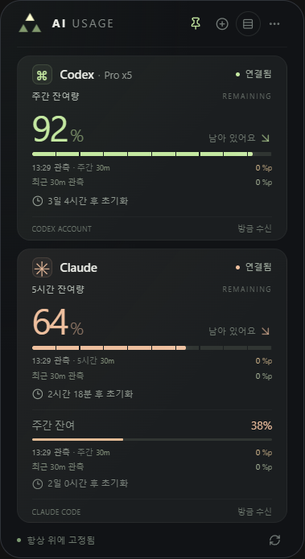
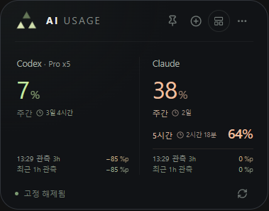
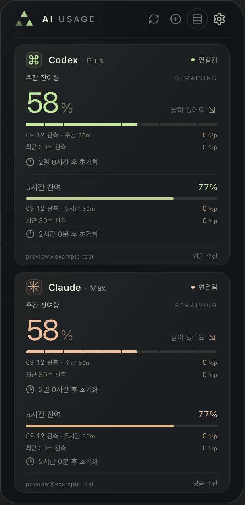

# AI Usage Viewer

Codex와 Claude의 구독 잔여량, 리셋 시간과 관측 사용량을 확인하는 앱입니다. Windows에서는 데스크톱 위젯으로, macOS에서는 메뉴 막대 앱 **AI Usage**로 사용합니다. 두 버전은 같은 카드·설정 UI를 사용하며 로그인과 조회는 각 운영체제의 공식 CLI가 처리합니다.

| 항목 | Windows | macOS |
|---|---|---|
| 실행 방식 | WPF + WebView2 데스크톱 위젯 | AppKit + WebKit 메뉴 막대 앱 |
| 앱 파일 | Releases의 `Mellow.AIUsageViewer-win-Setup.exe` | CPU에 맞는 Releases ZIP의 `AI Usage.app` 번들 전체 |
| 실행 | 시작 메뉴의 설치본 또는 `run-widget.cmd` | `AI Usage.app` 또는 `run-macos.command` |
| 보기 모드 | 자세히 · 간략히 · 로고만 보기 | 자세히 · 간략히 보기, 메뉴 막대로 닫기 |
| 창 조작 | 드래그, 항상 위에 표시, 모서리 배치 | 메뉴 막대 아이콘으로 열기, 바깥 클릭으로 닫기 |
| 새로고침 | 카드 하단 버튼 · `F5` | 카드 상단 버튼 · `⌘R` · `F5` · 아이콘 우클릭 메뉴 |
| 사용자 데이터 | `%LOCALAPPDATA%\AIUsageWidget` | `~/Library/Application Support/AIUsageWidget` |

- [Windows 버전](#windows-버전)
- [macOS 버전](#macos-버전)
- [공통 기능과 계정 관리](#공통-기능과-계정-관리)
- [표시값과 사용량 측정](#표시값과-사용량-측정)
- [공통 문제 해결](#공통-문제-해결)
- [최근 반영된 변경](#최근-반영된-변경)
- [개발 문서](#개발-문서)

## Windows 버전

### 설치와 실행

Windows x64용 앱입니다. [최신 Releases](https://github.com/Mellow1213/AI_Usage_Viewer/releases/latest)의 `Mellow.AIUsageViewer-win-Setup.exe`로 설치합니다. 수동 실행용 ZIP을 사용하는 경우 EXE 외에 DLL, `Web`, `Bridge`를 포함한 전체 폴더가 필요합니다.

| 준비 항목 | 설명 |
|---|---|
| 화면 엔진 | [Microsoft Edge WebView2 Runtime](https://developer.microsoft.com/en-us/microsoft-edge/webview2/). 없다면 Evergreen Runtime을 설치합니다. |
| Codex 연결 | Windows에서 실행할 수 있는 공식 [Codex CLI](https://learn.chatgpt.com/docs/codex/cli)와 ChatGPT 계정 |
| Claude 연결 | Windows용 공식 [Claude Code CLI](https://code.claude.com/docs/en/setup#install-on-native-windows)와 Claude 구독 계정. 이 앱은 `claude.exe`를 찾습니다. |
| 네트워크 | 로그인과 사용량 조회 시 인터넷 연결 |

연결할 서비스의 CLI만 설치하면 됩니다. `build-widget.ps1`로 만든 배포본에는 .NET 런타임이 포함됩니다. 앱 실행에 .NET SDK나 UI 빌드용 Node.js는 필요하지 않지만, npm으로 설치한 CLI가 Node.js를 요구하는 것은 별개입니다.

1. 최신 Releases의 Windows 설치 파일을 실행합니다.
2. 시작 메뉴의 **AI Usage Viewer**를 엽니다. 저장소 폴더에서는 루트의 `run-widget.cmd`로 설치본을 실행할 수 있습니다.
3. [첫 계정 연결](#첫-계정-연결)에 따라 AI를 추가하고 로그인합니다.

WSL에만 설치한 Linux CLI는 이 Windows 앱의 실행 파일 탐색 대상이 아닙니다. 지원하는 설치 경로는 [Windows 개발 안내](UsageWidget/README.md#계정-격리와-서비스-연동)를 참고하세요.

### Windows 화면 조작

| 조작 | 동작 |
|---|---|
| 상단 `AI USAGE` 글자 영역 드래그 | 위젯 이동. 핀을 켠 상태에서도 이동할 수 있습니다. |
| 핀 버튼 | 다른 창 위에 항상 표시하거나 고정을 해제합니다. |
| 보기 전환 버튼 | 자세히 보기 ↔ 간략히 보기 |
| 삼각형 로고 클릭 / `Escape` | 로고만 보기로 접거나 이전 카드 모드로 돌아갑니다. |
| 로고만 보기에서 드래그 | 작은 로고 창을 이동합니다. 클릭 또는 `Enter`·`Space`로 이전 카드를 복원합니다. |
| `설정 → 화면 설정 → 화면 모서리` | 현재 모니터의 원하는 모서리에 배치합니다. |
| `설정 → 화면 설정 → 부드러운 화면 전환` | 카드 펼치기·접기 전환 효과를 설정합니다. |
| `설정 → 화면 설정 → 로고 항상 위에 표시` | 카드 고정과 별도로 로고를 다른 일반 창 위에 표시합니다. |
| `설정 → 화면 설정 → 전체 화면에서 로고 숨기기` | 같은 모니터의 전체 화면 앱을 사용하는 동안 로고를 숨깁니다. |
| 로고 우클릭 / `Shift+F10` / 트레이 우클릭 | 로고 고정·전체 화면 숨김·5분간 숨기기·복원을 제어합니다. |
| `설정 → 앱 업데이트` | GitHub의 새 버전을 확인·다운로드하고 원하는 때 재시작하여 적용합니다. |
| 하단 새로고침 버튼 / `F5` | 표시 중인 계정의 사용량을 갱신합니다. 단축키는 앱에 포커스가 있을 때 사용합니다. |
| `설정 → AI Usage 종료` | 앱을 종료합니다. |

카드 창은 폭 304 DIP, 로고만 보기는 48×48 DIP이며 Windows 배율에 맞춰 표시됩니다. 계정이 많으면 카드 영역을 스크롤할 수 있습니다. 위치·고정·보기 모드·모서리·전환 효과 설정을 저장합니다. 드래그를 놓은 위치에 따라 접기 기준 모서리가 정해지고 작업 표시줄을 피하며 펼칩니다.

로고만 보기에서도 사용량 조회와 집계는 계속됩니다. Windows의 동작 줄이기 설정은 로고의 조회·밝기 효과, 숫자·막대 효과에 적용하며 창 펼치기·접기는 앱의 별도 전환 설정을 따릅니다.

<details>
<summary>Windows 화면 예시</summary>

기존 Windows WPF + WebView2 빌드에서 캡처한 예시 데이터 화면입니다. 자세히·간략히·로고만 보기의 배치를 보여주며, 버튼 모양과 설정 구성은 현재 소스와 일부 다릅니다.





</details>

### Windows 소스 빌드

Windows, .NET 8 SDK, npm과 Node.js `^20.19.0 || >=22.12.0`이 필요합니다. 저장소 루트에서 실행합니다.

```powershell
.\build-dev-widget.ps1 -RestoreUI
.\run-dev-widget.cmd
```

React UI와 Windows x64 개발판을 `artifacts/dev-build`에 빌드하고, 계정·설정·WebView·로그는 `artifacts/dev-profile`로 분리합니다. 기존 `Release`와 실사용 설치본은 덮어쓰지 않습니다. 이후 의존성을 다시 설치할 필요가 없으면 `-RestoreUI`를 생략할 수 있습니다. **소스 변경은 실행 파일에 자동 반영되지 않으므로 Windows에서 다시 빌드해야 합니다.** 기본 `build-widget.ps1`의 출력은 기존처럼 `Release`이며 macOS 빌드는 이를 갱신하지 않습니다.

### Windows 업데이트와 제거

설치본은 **설정 → 앱 업데이트 → 업데이트 확인 → 다운로드 및 업데이트 → 재시작하여 적용**으로 GitHub Releases에서 업데이트합니다. 시작 후 한 번 확인하며, 계속 실행 중에는 직접 확인합니다. 자동 다운로드·주기적 확인·자동 적용은 하지 않습니다. `%LOCALAPPDATA%\AIUsageWidget`의 계정·설정·기록은 유지합니다. 설치 경로는 `%LOCALAPPDATA%\Mellow.AIUsageViewer`이며 `run-dev-widget.cmd`는 별도 개발 데이터를 사용합니다.

기존 1.1.0 로컬 피드 설치본은 `use-github-updates.ps1` 실행 후 한 번 재실행합니다. 수동 ZIP은 전체 폴더를 교체하거나 설치본으로 전환합니다. 개발자와 AI는 [필수 배포 가이드](docs/releasing.md)를 따릅니다.

제거할 때는 먼저 [연결 정리](#연결-정리와-개인정보)를 진행하고 종료한 뒤 Windows의 설치된 앱에서 제거합니다. 수동 ZIP은 배포 폴더를 삭제합니다. 전용 CLI 인증 상태와 설정까지 제거하려면 사용자 데이터 폴더도 삭제합니다.

| Windows 문제 | 확인할 내용 |
|---|---|
| EXE가 없거나 화면 파일을 불러오지 못함 | DLL·`Web`·`Bridge`를 포함한 `Release` 전체가 있는지 확인합니다. |
| WebView2 초기화 실패 | WebView2 Runtime을 설치한 뒤 다시 실행합니다. |
| 이미 실행 중이라는 메시지 | 기존 위젯을 사용하거나 `설정 → AI Usage 종료`로 종료한 뒤 다시 실행합니다. |
| 기존 Claude 상태줄 출력이 사라짐 | 이 앱이 기존 명령을 실행할 Git Bash를 확인합니다. `CLAUDE_CODE_GIT_BASH_PATH` 또는 `C:\Program Files\Git\bin\bash.exe`를 사용합니다. |

오류 로그는 `%LOCALAPPDATA%\AIUsageWidget\widget.log`입니다. 파일별 저장 내용과 이전 Claude 상태줄 복원 명령은 [Windows 개발 안내](UsageWidget/README.md#저장-파일과-이전-버전-호환)에 있습니다.

## macOS 버전

### 설치와 실행

macOS 13 이상에서 사용합니다. 배포된 **`AI Usage.app` 번들 전체**를 응용 프로그램 폴더 등 원하는 위치로 옮기고 실행하면 됩니다. `.app` 내부의 실행 파일만 꺼내서 옮기지 마세요. 앱 실행 파일·웹 UI·아이콘은 번들 안에 포함됩니다.

| 준비 항목 | 설명 |
|---|---|
| 앱 파일 | Mac의 CPU 아키텍처에 맞는 `AI Usage.app` |
| Codex 연결 | macOS용 공식 [Codex CLI](https://learn.chatgpt.com/docs/codex/cli)와 ChatGPT 계정 |
| Claude 연결 | macOS용 공식 [Claude Code CLI](https://code.claude.com/docs/en/setup)와 Claude 구독 계정 |
| 네트워크 | 로그인과 사용량 조회 시 인터넷 연결 |

앱 자체는 macOS 기본 AppKit·WebKit으로 실행되므로 WebView2·.NET·UI 빌드용 Node.js가 필요하지 않습니다. **공식 CLI와 로그인 상태는 앱 번들에 포함되지 않습니다.** npm으로 설치한 CLI에는 별도로 Node.js가 필요할 수 있습니다.

실행 후 메뉴 막대의 삼각형을 클릭하고 [첫 계정 연결](#첫-계정-연결)을 진행합니다. Dock에는 아이콘이 나타나지 않습니다.

### macOS 화면 조작

| 조작 | 동작 |
|---|---|
| 메뉴 막대의 삼각형 클릭 | 사용량 카드를 열거나 닫습니다. |
| 카드 밖 클릭 / `Escape` / 카드 상단 삼각형 | 카드를 닫고 메뉴 막대에 남깁니다. |
| 보기 전환 버튼 | 자세히 보기 ↔ 간략히 보기 |
| 카드 상단 새로고침 / `⌘R` / `F5` | 표시 중인 계정의 사용량을 갱신합니다. 단축키는 카드에 포커스가 있을 때 사용합니다. |
| 메뉴 막대 아이콘 우클릭 | `사용량 보기` · `새로고침` · `종료` 메뉴 |
| `설정 → 화면 설정 → 부드러운 화면 전환` | 메뉴 창과 보기 전환 애니메이션을 설정합니다. |
| `설정 → AI Usage 종료` | 앱을 종료합니다. |

macOS는 메뉴 막대에 연결된 팝오버 방식입니다. 창을 열린 채로 유지하는 기능, 항상 위에 고정, 드래그 이동, 모서리 배치와 별도의 로고만 보기 창은 제공하지 않습니다. 카드 하단의 `메뉴 막대에서 실행 중` 문구는 제거했으며 새로고침은 상단에 있습니다.

카드를 닫고 5초가 지나면 웹 화면을 메모리에서 해제합니다. 다시 열 때 최신 사용량, 자세히·간략히 보기, 설정 위치, 스크롤과 저장 전 별명 입력값을 복원합니다. 짧게 닫았다 열면 기존 화면을 그대로 사용하며, 해제 후에는 화면을 다시 불러오는 시간이 조금 필요합니다.

카드를 닫아도 앱이 실행 중이면 자동 조회와 집계는 계속됩니다. 다시 열면 최신 사용량을 표시하며 닫혀 있던 동안의 회전을 쌓아 재생하지 않습니다. 새로고침 애니메이션에서는 메뉴 막대 삼각형이 도형의 중심을 기준으로 한 바퀴 회전합니다. 앱의 전환 효과를 끄거나 macOS의 동작 줄이기를 켜면 메뉴 막대 애니메이션을 생략합니다.

<details>
<summary>현재 macOS 카드 화면</summary>

현재 macOS 앱의 WebKit 화면입니다. 계정과 사용량은 검증용 예시 데이터입니다.



</details>

### macOS 소스 빌드

Xcode Command Line Tools, npm과 Node.js `^20.19.0 || >=22.12.0`이 필요합니다. 개발 도구가 없다면 `xcode-select --install`로 설치하고 저장소 루트에서 실행합니다.

```bash
./build-macos.sh
./run-macos.command
```

결과는 `artifacts/macos/AI Usage.app`입니다. `run-macos.command`는 앱이 없을 때만 빌드하므로 **소스를 수정하거나 업데이트한 뒤에는 `build-macos.sh`를 다시 실행해야 합니다.** 빌드가 끝난 앱은 저장소 밖으로 옮겨서 실행할 수 있습니다.

스크립트는 현재 Mac의 CPU용으로 빌드합니다. Apple Silicon에서는 `arm64`, Intel에서는 `x86_64`이며 Universal Binary를 만들지는 않습니다. 로컬 빌드는 임시 코드 서명(ad-hoc signing)을 사용합니다. 다른 사용자에게 배포할 때 필요한 Developer ID 서명·공증·대상 아키텍처 검증은 별도입니다.

### macOS 업데이트와 제거

업데이트할 때는 메뉴 막대 아이콘 우클릭 → `종료` 또는 `설정 → AI Usage 종료`로 종료한 뒤 **`AI Usage.app` 전체**를 교체합니다. `~/Library/Application Support/AIUsageWidget`을 유지하면 계정 목록·별명·보기·집계 설정과 관측 기록을 이어서 사용합니다.

제거할 때는 먼저 [연결 정리](#연결-정리와-개인정보)를 진행하고 종료한 뒤 `.app`을 삭제합니다. 전용 CLI 인증 상태와 설정까지 제거하려면 사용자 데이터 폴더도 삭제합니다.

| macOS 문제 | 확인할 내용 |
|---|---|
| 실행해도 창이나 Dock 아이콘이 보이지 않음 | 메뉴 막대의 삼각형을 클릭합니다. |
| 앱 실행 불가·아키텍처 불일치 | macOS 13 이상인지, Mac에 맞는 아키텍처와 서명·공증 상태의 배포본인지 확인합니다. |
| 터미널에서는 CLI가 실행되지만 앱에서 찾지 못함 | 앱을 다시 실행하고 탐색 경로를 확인합니다. 사용자 지정 경로는 [macOS 개발 안내](MacUsageWidget/README.md#cli-탐색과-로그인)를 참고하세요. |
| 소스를 바꿨는데 이전 화면이 나옴 | 실행 중인 앱을 종료하고 `build-macos.sh`로 다시 빌드한 경로의 앱을 실행합니다. |
| 앱을 옮긴 뒤 Claude 상태줄이 갱신되지 않음 | 새 위치의 앱을 실행하고 새로고침합니다. 앱이 설치한 상태줄 명령의 경로를 갱신하며 사용자가 나중에 바꾼 상태줄은 덮어쓰지 않습니다. |

## 공통 기능과 계정 관리

### 첫 계정 연결

1. **AI 선택하기** 또는 상단 **+**에서 Codex·Claude를 추가합니다. 처음 실행할 때 기존 CLI 계정을 자동 연결하지 않습니다.
2. 추가한 계정의 로그인 항목이 열립니다. 나중에는 **톱니바퀴 설정 → 계정 관리**에서 계정을 펼칩니다.
3. **ChatGPT로 로그인** 또는 **공식 Claude Code로 로그인**을 선택하고 공식 브라우저·CLI 화면에서 직접 완료합니다. macOS의 Claude 로그인은 Terminal에서 진행합니다.
4. 이미 CLI에 로그인했다면 해당 AI의 첫 계정 카드에서 **기존 CLI 계정 사용**을 선택할 수 있습니다. 추가 계정은 앱 전용 로그인으로 연결합니다.
5. 설정을 닫고 잔여량을 확인합니다. 필요하면 새로고침합니다.

이전에 연결한 계정은 앱 시작·업데이트 후 **자동 연결 중입니다…**로 표시됩니다. 확인이 끝나면 연결됨·로그인 필요·연결 오류로 바뀌며, 자동 연결 중에는 다시 로그인하라는 안내가 나오지 않습니다.

Codex 로그인 중에는 **로그인 취소**와 **브라우저 다시 열기**를 사용할 수 있습니다. Claude는 열린 CLI 창의 입력 대기도 확인하세요. 로그인 제한 시간은 5분입니다.

같은 AI를 여러 번 추가해 서로 다른 계정을 확인할 수 있습니다. 각 계정의 로그인·잔여량·리셋 시간·관측 기록을 독립적으로 관리하며 선택 목록과 순서를 저장합니다. 기존 CLI 계정을 사용한 카드는 해당 CLI의 계정 변경을 따라갑니다.

### 설정 구성

| 설정 | 내용 |
|---|---|
| 계정 관리 | AI 추가, 로그인·로그아웃·연결 해제, 별명, 계정 항목 삭제 |
| 사용량 측정 | 집계 주기와 비교 구간 |
| 사용 기록 | 최근 90일의 일별·시간별·주별 관측 기록 |
| 화면 설정 | 부드러운 화면 전환. Windows에서는 항상 위에 표시와 모서리 배치도 제공 |

하위 화면의 뒤로가기는 상위 설정으로, 닫기는 사용량 화면으로 돌아갑니다. 간략히 보기에서 설정을 열어도 닫으면 원래 보기 모드를 유지합니다.

별명은 계정을 펼쳐 입력하고 **저장**합니다. 최대 24자이며 `Codex · 개인용`처럼 표시합니다. 비우고 저장하면 기본 이름으로 돌아갑니다. 별명 변경은 로그인과 관측 기록에 영향을 주지 않습니다.

### 계정 삭제와 연결 해제

| 동작 | 결과 |
|---|---|
| 계정 항목 삭제 | 카드·계정 목록·저장된 별명을 제거합니다. 다시 실행해도 복원 목록에 남지 않습니다. 해당 Claude 상태줄 연결도 해제합니다. |
| 앱 전용 계정 로그아웃 | 공식 CLI를 통해 해당 전용 계정을 로그아웃합니다. 카드 항목은 유지합니다. |
| 기존 CLI 계정 연결 해제 | 앱 연결만 끊습니다. 기존 CLI 자체는 로그아웃하지 않습니다. |
| 다른 계정으로 로그인 | 해당 카드의 전용 로그인 계정을 변경합니다. |

**계정 항목 삭제는 CLI 로그인 파일과 로컬 관측 기록을 지우지 않습니다.** 로그아웃도 원한다면 항목을 삭제하기 전에 먼저 로그아웃하세요. 이전 버전에서 숨긴 계정은 계정 관리에 남아 있을 수 있으며 해당 계정을 펼쳐 삭제할 수 있습니다. 이미 삭제한 항목은 `카드 다시 표시` 대상으로 남지 않습니다.

### Claude Code와 연결

공식 CLI의 인증·사용량 조회 기능을 사용하며 자동 사용량 조회를 위해 Claude에 메시지나 도구 요청을 보내지 않습니다. 사용량 조회는 실험적 `get_usage` 제어 요청에 의존하므로 CLI 버전에 따라 지원 여부가 달라질 수 있습니다. 실패 시 사용할 수 있는 마지막 상태줄 수신값을 유지합니다.

**이 계정으로 Claude Code 열기**에서 작업 폴더를 선택하면 같은 계정으로 CLI를 실행합니다. 해당 세션의 공식 [상태줄 데이터](https://code.claude.com/docs/en/statusline)도 받습니다. CLI 대화 창을 닫아도 앱의 자동 조회는 계속됩니다.

상태줄 연결 시 이전 설정을 백업하고 연결 해제 시 앱이 설치한 상태줄만 복원해 다른 설정 변경을 유지합니다. Windows에서 기존 상태줄 명령의 출력을 보존하려면 Git Bash가 필요합니다. macOS에서는 `/bin/sh`로 실행합니다.

### 연결 정리와 개인정보

앱 제거 전 `설정 → 계정 관리`에서 남아 있는 전용 계정은 **로그아웃**, 기존 CLI 계정은 **연결 해제**합니다. Claude 상태줄도 이때 복원되므로 앱 파일을 먼저 삭제하지 마세요. 이미 삭제한 계정의 전용 CLI 로그인 파일은 사용자 데이터 폴더에 남아 있을 수 있습니다.

앱은 사용량을 확인하기 위해 모델 요청이나 대화를 만들지 않습니다. 인증 처리는 공식 CLI에 위임하며 앱의 사용량 기록에 대화 내용을 저장하지 않습니다. 다만 **사용자 데이터 폴더에는 공식 CLI의 인증 상태, 계정 식별 정보와 Claude 설정 백업이 포함될 수 있으므로** 배포본이나 문제 보고에 데이터 폴더 전체를 포함하지 마세요.

두 운영체제의 데이터 경로와 설정 파일은 별도이며 자동으로 동기화되지 않습니다. 앱 파일만 옮기면 다른 컴퓨터로 계정이나 설정이 이전되는 것은 아닙니다. 저장 파일은 [Windows](UsageWidget/README.md#저장-파일과-이전-버전-호환)·[macOS](MacUsageWidget/README.md#저장-파일과-계정-격리) 개발 안내에 정리했습니다.

## 표시값과 사용량 측정

### 사용 기록

`설정 → 사용 기록`에서 필요할 때 기록 화면을 엽니다. 기본 위젯과 기존 관측 집계 표시는 유지됩니다. 처음 열면 최근 7일의 **일별** 기록을 표시하며, **시간별**은 선택한 하루(가로 스크롤), **주별**은 월요일 시작 8주를 보여줍니다. 화살표로 이전·다음 기간을 이동하고 계정·한도 선택으로 서로 다른 기준을 구분합니다. 각 막대를 선택하면 관측 시간과 소비량을 확인할 수 있습니다.

- `0`: 관측한 구간에서 소비 증가분이 없었습니다.
- 점선 `일부 관측`: 구간 중 일부만 수신했습니다. 표시한 소비량은 관측된 부분의 합계입니다.
- 빗금 `— / 미관측`: 해당 구간을 관측하지 못했습니다. 사용량 0을 뜻하지 않습니다.

새 기록은 업데이트 후 새로 수신한 값부터 기기 내 `usage-history.json`에 최근 90일 동안 보관합니다. 기존 48시간 측정 기록을 전체 사용 기록으로 소급 변환하지 않습니다. 앱 재실행·연결 오류·카드 제외·10분 초과 수신 공백·한도 초기화 전후는 이어 붙이지 않고, 다시 기준을 잡은 다음 수신부터 쌓습니다. 초기화와 날짜 변경은 과거 기록을 지우지 않습니다. 조회 간격 안에서 수신한 한도 변화량을 수신 시각에 기록하므로 실제 작업 시각과 차이가 날 수 있습니다.

기기 현지 시간으로 묶으며 주별 기록은 서비스의 주간 한도 초기화 주기와 다릅니다. 계정·플랜·한도 기준이 바뀌면 별도 기록으로 분리하고, 서로 다른 한도의 %p를 합산하지 않습니다. 화면의 합계는 선택한 한도의 **관측된 부분만 합산한 값**이며 토큰 수·요금·하루 전체 소비량이 아닙니다. 이메일·인증 정보·대화 내용은 기록 파일에 저장하지 않습니다.

### 위젯 표시값

**관측 사용량은 앱이 수신한 한도 변화량입니다. 하루 전체 사용량이나 토큰 수가 아닙니다.** 5시간 한도와 주간 한도는 각각 계산합니다.

| 표시 | 의미 |
|---|---|
| 잔여량 `77%` | 서비스가 제공한 해당 한도의 남은 비율. API 비용이나 컨텍스트 사용률과는 별개입니다. |
| `09:30 관측 −3%p` | 오늘 관측한 소비량과 마지막 수신 시각. 잔여량이 80%에서 77%로 줄었다면 3퍼센트포인트를 소비한 것으로 관측합니다. |
| `최근 30m 관측` | 마지막 집계 시각을 기준으로 선택한 비교 구간에 수신된 소비량의 합계 |
| 리셋까지 남은 시간 | 해당 한도의 초기화 예정 시각까지 남은 시간. 마우스를 올리면 현지 시간대의 날짜·시각을 확인할 수 있습니다. |
| `—` / `초기화됨` | 값이 없거나 리셋 뒤 새 수신값을 기다리는 상태. 데이터가 없다고 100%로 표시하지 않습니다. |
| `이전 수신값` | 마지막 수신 후 5분이 지난 값 |
| `집계 대기` | 날짜가 바뀐 뒤 오늘의 첫 집계가 아직 완료되지 않은 상태 |
| 계정 플랜 | 연결 정보에 있는 플랜. 정보가 없으면 생략하며 Claude의 배수 정보를 임의로 추가하지 않습니다. |

자세히 보기에서는 주간 한도를 우선 표시하고 다른 한도도 따로 보여줍니다. 간략히 보기에서 Claude는 **주간 잔여량을 크게**, 5시간 잔여량을 보조 행으로 표시하며 관측 누적치도 주간 기준입니다. Codex는 5시간 한도가 있으면 우선 표시합니다.

| 조회·집계 | 주기·설정 |
|---|---|
| Codex 자동 조회 | 앱 실행 중 60초 간격 |
| Claude 자동 조회 | 연결 직후·재실행 시, 이후 5분 간격 |
| 수동 새로고침 | 표시 중인 계정을 즉시 조회. 운영체제별 버튼·단축키는 위 안내 참고 |
| 집계 주기 | 기본 30분. 1분~3시간, 1분 단위 |
| 비교 구간 | 기본 30분. `30m · 1h · 3h · 6h · 12h · 1d` |

Windows와 macOS 모두 계정·사용량 조회가 끝나면 앱이 시작한 Codex 조회 프로세스를 종료하고 다음 조회 때 다시 연결합니다. 로그인 진행 중인 연결은 유지하며, CLI 인증 파일과 마지막 수신값은 보존합니다. 조회 주기와 기능은 그대로 유지합니다.

관측 표시를 클릭하거나 `설정 → 사용량 측정`에서 변경합니다. 집계 주기 슬라이더는 놓거나 키보드 조작을 마치면 저장됩니다. **집계 주기를 줄여도 서비스 조회가 더 자주 발생하지 않으며 AI 모델 요청을 추가하지 않습니다.** 새 수신값이 없으면 집계 시각을 갱신하지 않습니다.

수신 시각은 현지 시간의 24시간 `HH:mm` 형식이며 자정은 `00:00`입니다. 관측 표시에 마우스를 올리면 관측 시작·집계·집계에 반영된 수신 시각을 구분해 확인할 수 있습니다. 새 값을 받으면 수신 시각을 갱신하고 캐시를 다시 읽을 때는 원본 수신 시각을 유지합니다.

오늘 관측한 현재 한도의 소비 구간은 막대에 옅은 색으로 남습니다. 한도가 초기화되면 해당 한도의 누적 소모량·최근 소모량·막대 소비 구간을 함께 0으로 비우고 이후 관측부터 다시 쌓습니다. 초기화권·회사 측 초기화로 잔여량이 100%가 되는 경우에도 적용하며 다른 한도는 유지합니다. 초기화는 새 사용량 수신 시 집계 주기와 관계없이 반영합니다. 현지 자정에는 새 누적 기준을 잡으며 같은 날 재실행하면 저장된 기록을 복원합니다. **첫 관측 전, 앱 종료·잠자기·미수신 중의 소비와 초기화 사이의 사용은 복원할 수 없습니다.**

## 공통 문제 해결

| 증상 | 확인할 내용 |
|---|---|
| CLI 설치 안내가 계속 표시됨 | 새 터미널에서 `codex --version` 또는 `claude --version`을 확인하고 앱을 다시 실행합니다. 플랫폼별 탐색 경로도 확인합니다. |
| 로그인 미완료·다른 계정 연결 | `설정 → 계정 관리`에서 이메일과 연결 방식을 확인합니다. 취소 후 다시 로그인하고 브라우저에서 원하는 계정을 선택합니다. Claude는 CLI 창의 입력도 완료해야 합니다. |
| 구독 한도·잔여 비율 미제공 | Codex는 ChatGPT 계정, Claude는 Claude 구독 계정으로 로그인했는지 확인합니다. API 키 로그인 등 잔여 비율을 제공하지 않는 계정은 표시할 수 없습니다. |
| Claude 자동 조회 실패·수신 대기 | 공식 CLI 버전·로그인·네트워크를 확인하고 새로고침합니다. 자동 조회가 지원되지 않으면 연결된 Claude Code 세션의 상태줄 수신을 사용할 수 있습니다. |
| 이전 수신값·조회 실패·초기화됨 | 마지막 수신 시각과 연결 상태를 확인합니다. 리셋 뒤에는 새 한도를 받아야 잔여량이 표시됩니다. |
| 잔여량은 바뀌는데 관측 누적치는 그대로 | 설정한 집계 주기가 지났는지 확인합니다. 수신 시각과 누적치 집계 시각은 별도로 관리합니다. |
| 설정·계정 항목 삭제 실패 | 사용자 데이터 폴더의 쓰기 권한을 확인합니다. Claude 계정은 상태줄 설정의 쓰기 권한도 필요합니다. |

문제를 보고할 때는 운영체제, 앱에 표시된 메시지, CLI 버전과 재현 순서를 함께 적어주세요.

## 최근 반영된 변경

현재 소스에 반영된 변경 사항입니다. Windows 실행 배포본은 Windows에서 다시 빌드해야 적용됩니다.

- **메모리 사용 개선:** 조회가 끝난 Codex 프로세스를 정리하고, macOS는 닫은 메뉴 창의 웹 화면을 해제합니다. 설정·입력 상태와 백그라운드 조회는 보존합니다.
- **macOS 메뉴 막대 앱 추가:** `.app` 번들 실행, 상단 새로고침, 아이콘 우클릭 메뉴, 카드가 닫혀 있어도 백그라운드 조회 지원.
- **플랫폼별 창 동작 정리:** Windows의 이동·핀·로고만 보기는 유지하고 macOS는 바깥 클릭으로 닫히는 메뉴 막대 카드로 동작합니다.
- **설정 재구성:** 톱니바퀴 아이콘과 `계정 관리`·`사용량 측정`·`화면 설정`으로 분리했습니다.
- **계정 항목 삭제:** Windows·macOS 모두 숨기기 대신 계정 태그·별명을 목록에서 제거하고 재실행 시 복원 목록에 남기지 않습니다.
- **삼각형 회전 수정:** 자세히 → 간략히는 시계 방향 120도, 반대는 반시계 방향 120도입니다. 새로고침은 한 번의 갱신에 한 바퀴를 돌고 빨리 끝나도 역회전하지 않으며 겹친 갱신을 추가 회전으로 쌓지 않습니다. 오래 닫아 둔 macOS 카드를 다시 열 때 밀린 회전을 재생하지 않습니다.
- **아이콘 정렬 수정:** 메뉴 막대 삼각형의 회전 중심, 새로고침·설정 등 버튼의 중앙 정렬, Codex 앞의 ⌘ 아이콘을 보정했습니다. ⌘는 글꼴에 영향을 받지 않는 SVG로 표시합니다.

## 개발 문서

- [Windows 개발 안내](UsageWidget/README.md): WPF·WebView2 빌드, 저장 파일, 계정 연동, 통합 검증, 배포
- [macOS 개발 안내](MacUsageWidget/README.md): Swift·WebKit 빌드, `.app` 배포, CLI 탐색, 저장 파일, 검증
- [성능 비교 기록](docs/performance.md): Windows 반복 갱신 최적화의 측정 조건과 결과
- [메모리 비교 기록](docs/memory.md): 조회 프로세스 정리, macOS 화면 해제·복원, 측정 조건과 결과

공통 UI는 `WidgetUI`, Windows 호스트는 `UsageWidget`, macOS 호스트는 `MacUsageWidget`에 있습니다. 두 플랫폼은 각자의 빌드 스크립트를 사용합니다.
